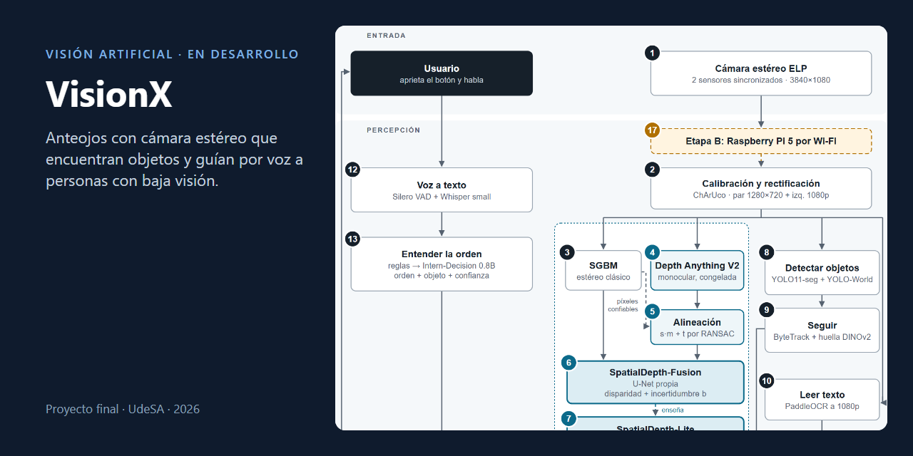
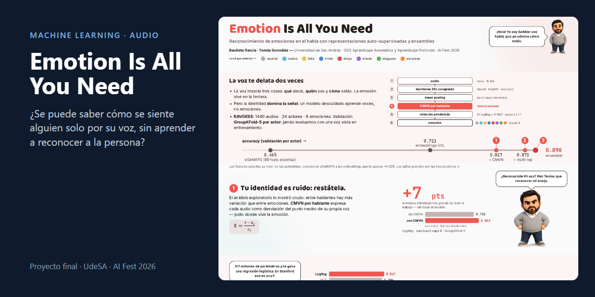
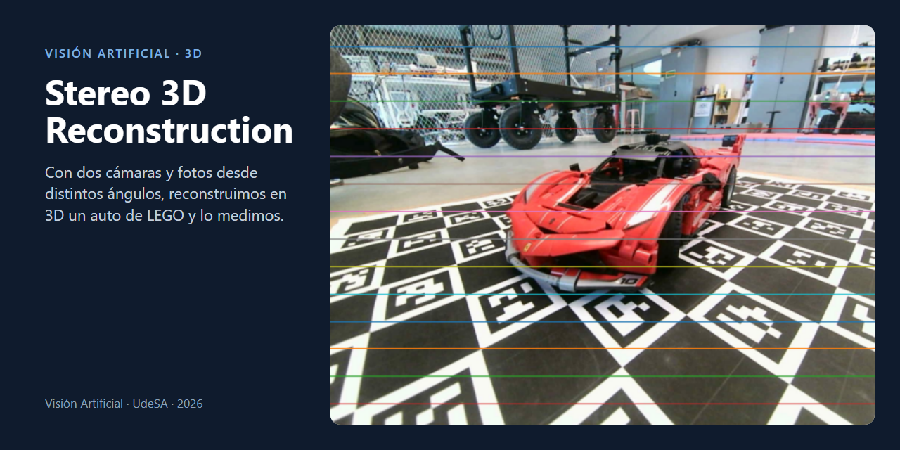
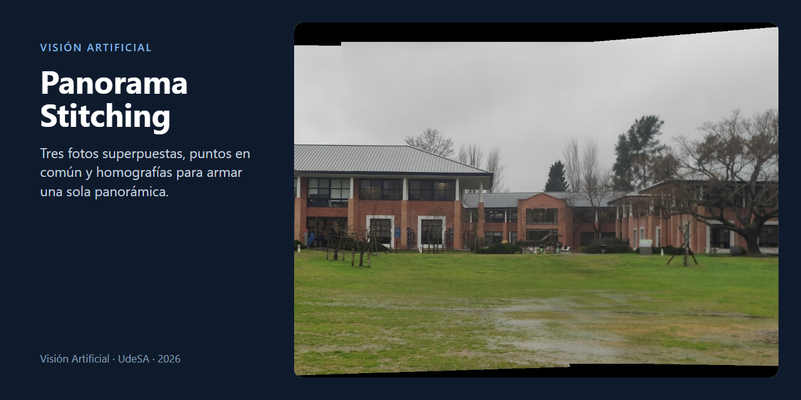
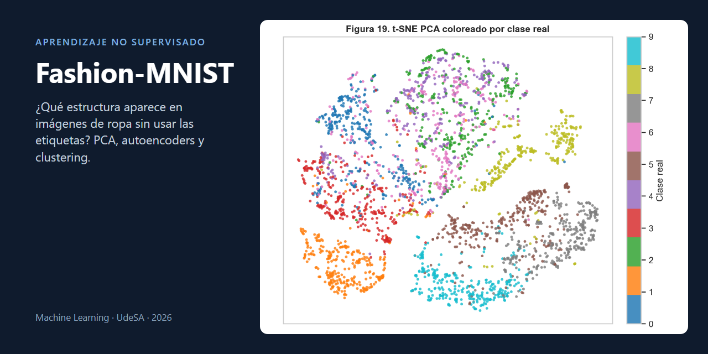
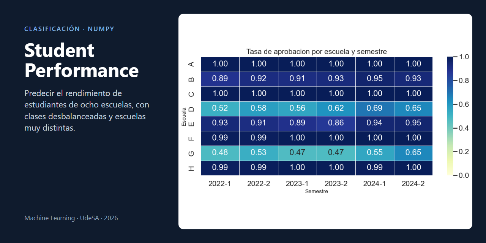
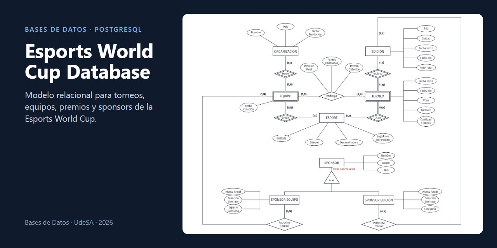

# Tomás González

Estudio **Ingeniería en Inteligencia Artificial en la Universidad de San Andrés** y soy **Técnico Electromecánico** egresado de la Escuela Técnica Henry Ford.

Me interesa desarrollar sistemas que combinen aprendizaje automático, percepción y robótica. Mi perfil reúne proyectos académicos individuales y en equipo.

## Con qué trabajo

**Lenguajes y bases de datos**

   

**Machine Learning y visión**

    

**Entorno de desarrollo**

  

Trabajo con entrenamiento y evaluación de modelos, validación cruzada, procesamiento de imágenes y audio.

Mi formación electromecánica incluye **Solid Edge, diseño para impresión 3D, Arduino y Raspberry Pi**.

## Actualmente: VisionX

Desarrollo **[VisionX](https://github.com/TomaasGonzalezzz/VisionX)** junto a **Bautista García**, como proyecto final de Visión Artificial en UdeSA: anteojos con cámara estéreo para personas con baja visión. El usuario pide un objeto y el sistema lo encuentra, calcula a qué distancia está y lo guía por voz hasta él; también busca leer textos y describir la escena.

El proyecto combina calibración de cámaras, detección de objetos y estimación de profundidad. Además, estamos desarrollando una **red propia que combina varias estimaciones de profundidad** e indica cuánto confiar en cada una. La primera demo está prevista con cámara USB y procesamiento local.

## Proyectos seleccionados

<table>
<tr>
<td width="50%"> <b>Emotion Is All You Need</b> Reconocer emociones en la voz sin que el modelo aprenda a reconocer a la persona.</td>
<td width="50%"> <b>Stereo 3D Reconstruction</b> Reconstrucción y medición en 3D de un auto de LEGO a partir de fotos estéreo.</td>
</tr>
<tr>
<td> <b>Panorama Stitching</b> Panorámicas con SIFT, RANSAC y homografías implementadas con NumPy.</td>
<td> <b>Fashion-MNIST: Unsupervised Learning</b> PCA, autoencoders, β-VAE y clustering sobre imágenes de ropa.</td>
</tr>
<tr>
<td> <b>Student Performance Classification</b> Clasificación desde cero con NumPy, validación por escuela y clases desbalanceadas.</td>
<td> <b>Esports World Cup Database</b> Modelo relacional en PostgreSQL con roles, restricciones y consultas.</td>
</tr>
</table>

Otros trabajos: [redes neuronales sobre EMNIST](https://github.com/TomaasGonzalezzz/EMNIST-Neural-Networks) y [regresión de precios de viviendas](https://github.com/TomaasGonzalezzz/Housing-Price-Regression).

Además, doy clases particulares de ciencias exactas desde 2021 y participé en proyectos de ingeniería aplicada, incluido un guante de comunicación para personas sordociegas premiado por el Rotary Club de Tigre en 2023.

Busco oportunidades de **desarrollo en IA, Machine Learning y Computer Vision**, especialmente proyectos freelance, pasantías o posiciones remotas de dedicación parcial.

[LinkedIn](https://www.linkedin.com/in/tomas-gonzalez-213a511b5/) · Buenos Aires, Argentina · Español nativo / Inglés B2
